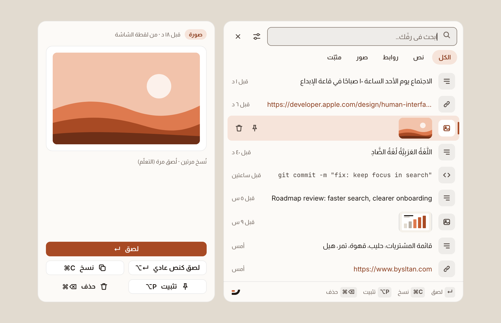
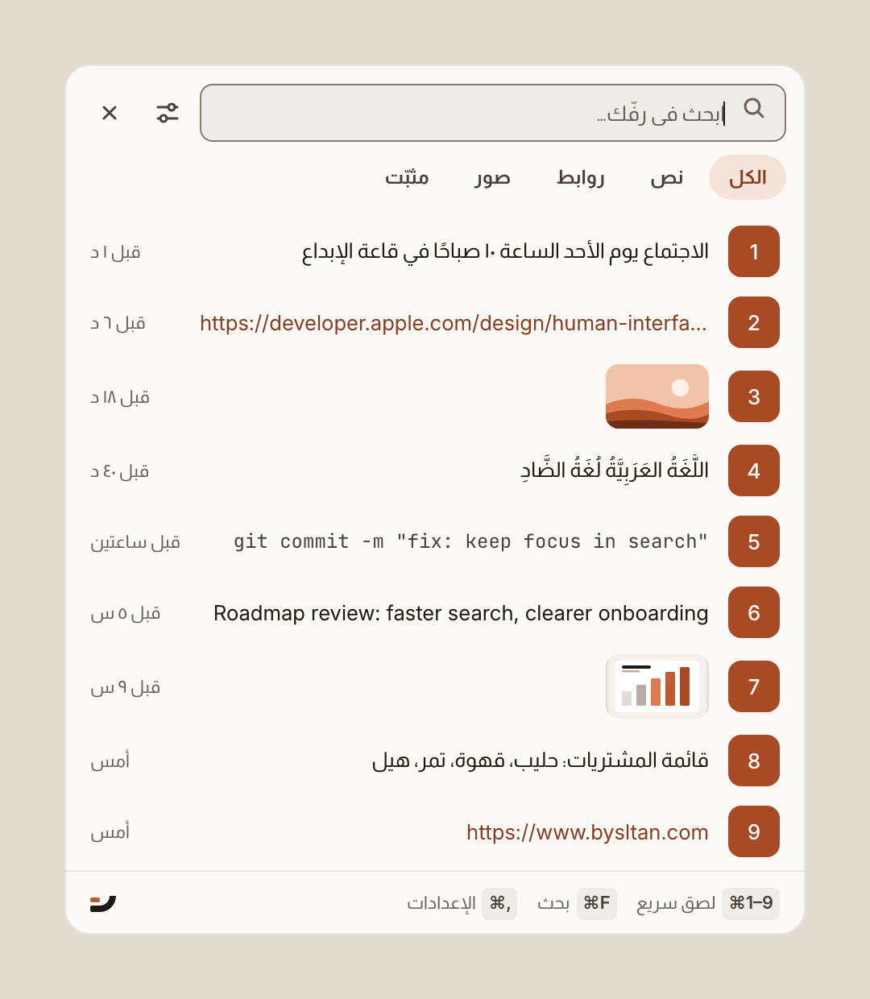
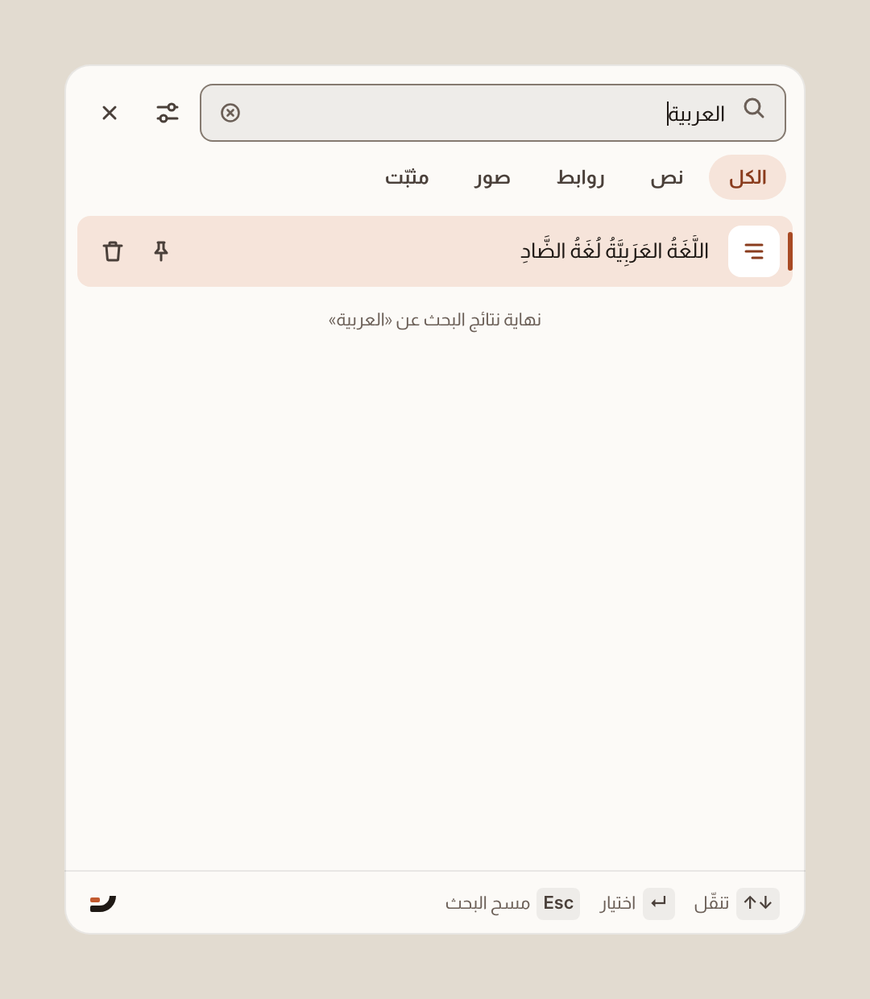
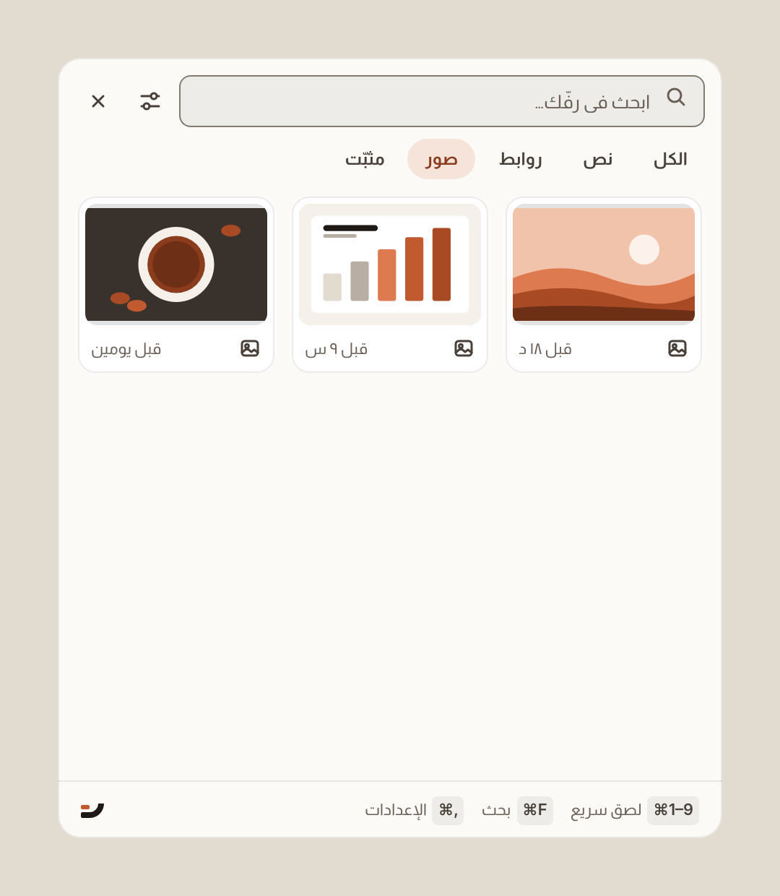
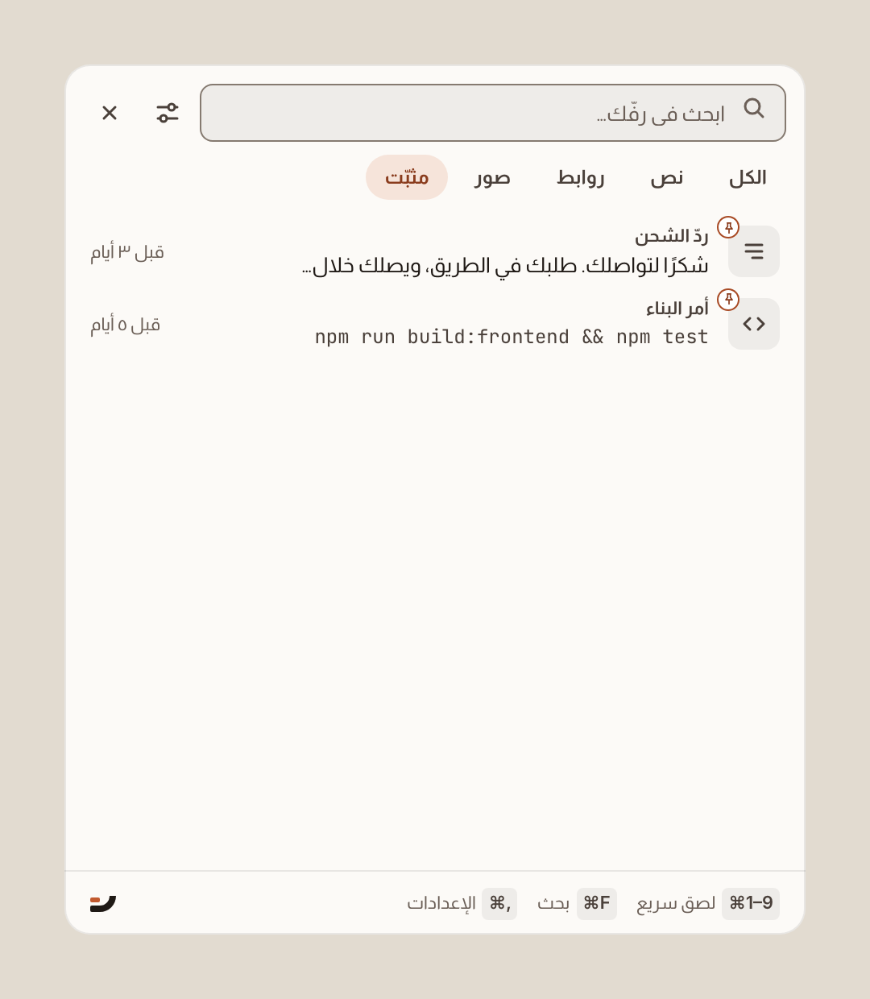
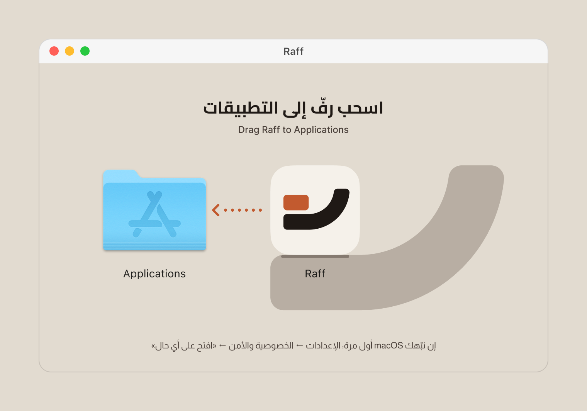
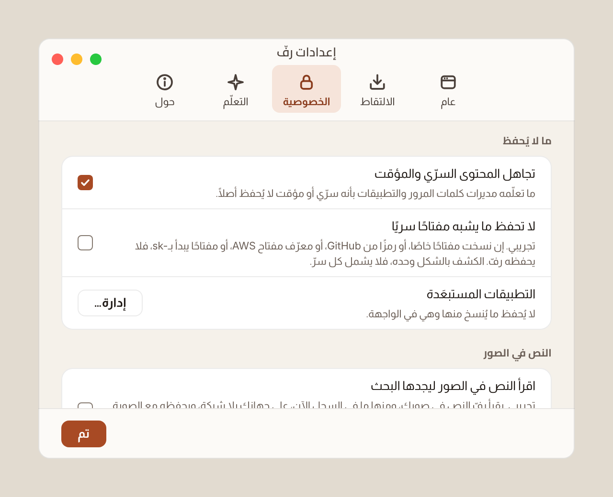

<!--
  صور README في docs/assets/readme/، ومصدرها ملف Figma XCNmucSuAe007qWHnOXQpW، صفحة «05 — DMG & README».
  اللقطات من واجهة رفّ نفسها ببيانات مصطنعة. والأيقونة فاتحة دائمًا.
-->

<div dir="rtl">

<div align="center">


# رفّ

**مدير حافظة عربي لـ macOS. يحفظ ما تنسخه على جهازك، ويعيده إليك بضغطة من أي تطبيق.**

مجاني · macOS 12 أو أحدث · Apple Silicon · بلا حساب ولا سحابة

[الميزات](#الميزات) · [الاستخدام](#الاستخدام) · [التثبيت](#التثبيت) · [الخصوصية](#الخصوصية) · [المتطلبات](#المتطلبات) · [التنزيل](#التنزيل) · [الأسئلة](#الأسئلة-المتكررة)

</div>


<picture>
  <source media="(prefers-color-scheme: dark)" srcset="docs/assets/readme/hero-dark.png">
  
</picture>

<sub>لقطات من واجهة رفّ نفسها ببيانات مصطنعة، لا من حافظة أحد.</sub>

## ما هو رفّ؟

تنسخ رابطًا، ثم فقرة، ثم صورة، وحين تحتاج الرابط الأول تجده قد ضاع: حافظة macOS تحفظ شيئًا واحدًا.

رفّ يسكن شريط القوائم، ويحفظ ما تنسخه في سجل على جهازك. تفتحه بـ <span dir="ltr"><kbd>⇧</kbd><kbd>⌘</kbd><kbd>V</kbd></span> من أي تطبيق، فتختار عنصرًا فيُلصق حيث كنت. وما تحتاجه دائمًا تثبّته فلا يُحذف.

| الطبقة | ما فيها |
| --- | --- |
| **الأخير** | سجل تلقائي لما نسخته: نصوص وروابط وشفرات وصور. |
| **المثبّت** | ما تختار إبقاءه. لا يُحذف بحدّ السجل ولا بمدة الاحتفاظ. |

<sub>والشعار يرسم الفكرة: «ر» تصير رفًّا، وعليه بطاقة هي آخر ما نسخت.</sub>

## الميزات

<sub>◆ جديد في 7.0.</sub>

**الأساس**

- **يفتح من أي مكان.** <span dir="ltr"><kbd>⇧</kbd><kbd>⌘</kbd><kbd>V</kbd></span> أو نقرة على رمزه في شريط القوائم. الاختصار يتغير من الإعدادات.
- **لصق سريع.** أمسك <kbd>⌘</kbd> فتظهر أرقام أول تسعة عناصر، والصق أيًّا منها بـ <span dir="ltr"><kbd>⌘</kbd><kbd>1</kbd></span> إلى <span dir="ltr"><kbd>⌘</kbd><kbd>9</kbd></span>.
- **بحث عربي.** يتجاهل التشكيل والتطويل، ويعدّ «أ» و«إ» و«آ» ألفًا، و«ى» ياءً، والأرقام الهندية كالعربية. تكتب «العربية» فتجد «العَرَبِيَّةُ».
- **لصق كنص عادي.** <span dir="ltr"><kbd>⌥</kbd><kbd>⏎</kbd></span> يلصق العنصر بلا تنسيق.
- **تحت سيطرتك.** استبعد تطبيقات بعينها، أو أوقف الالتقاط مؤقتًا، أو اختر سعة السجل (200 أو 500 أو 1000 عنصر) ومدة الاحتفاظ به.
- **يتجاهل المحتوى السرّي والمؤقت.** ما تعلّمه مديرات كلمات المرور والتطبيقات بأنه سرّي أو مؤقت لا يُحفظ أصلًا. الخيار مفعّل افتراضيًا.
- **يقول لك حين لا يحفظ.** رمز شريط القوائم يتغير مع حالة الالتقاط، واللوحة والإعدادات تعرض السبب وزرًّا يعالجه.
- **أبلغ عن مشكلة من داخله.** تكتب ما حدث، وترى البلاغ كاملًا قبل إرساله، ثم يظهر لك رقمه.
- **عربي من الأساس.** واجهة من اليمين إلى اليسار، ومظهر تلقائي يتبع النظام، أو فاتح، أو داكن.

**جديد في 7.0**

- ◆ **معاينة بجانب اللوحة.** استقرّ بالمؤشر على عنصر، أو انقر عليه بالزر الأيمن، أو اضغط المسافة أو <span dir="ltr"><kbd>⌘</kbd><kbd>Y</kbd></span>. تظهر النص حتى ألف حرف أو الصورة، ومتى نُسخ ومن أين، ومتى يُحذف.
- ◆ **لصق بلا تشكيل.** <span dir="ltr"><kbd>⌃</kbd><kbd>⏎</kbd></span> يلصق النص بلا حركات ولا تطويل، والعنصر المحفوظ لا يتغير.
- ◆ **الصور شبكة.** في «صور» تظهر بطاقات، ثلاثًا في الصف.
- ◆ **تسمية المثبّت.** اسم حتى ٤٠ حرفًا يظهر فوق نصه ويجده البحث، بـ <span dir="ltr"><kbd>⌥</kbd><kbd>L</kbd></span> أو من المعاينة.
- ◆ **نسخة احتياطية.** «تصدير…» يحفظ المثبّتات وأسماءها مع الإعدادات في ملف JSON تختار مكانه، بلا صور ولا سجل، و«استيراد…» يضيف منه ما ليس على رفّك. نص المثبّتات فيه مقروء، وهو خارج مجلد رفّ فلا يمسحه «مسح السجل»: احذفه حين لا تحتاجه.
- ◆ **هوية «نجدي».** ألوان رملية وقرميد، وشعار وأيقونات جديدة.

**تجريبي، ومعطّل افتراضيًا** ◆

- **لا تحفظ ما يشبه مفتاحًا سريًا.** مفتاح خاص، أو رمز وصول شخصي من GitHub، أو معرّف مفتاح AWS، أو مفتاح يبدأ بـ <span dir="ltr">`sk-`</span>. الكشف بالشكل وحده، فلا يعرف كل سرّ.
- **اقرأ النص في الصور ليجدها البحث.** يقرؤه macOS على جهازك بلا شبكة. والعربية على إصدارات macOS التي تدعمها. وإيقاف الخيار يمحو كل نص استخرجه.

<table>
  <tr>
    <td width="50%" valign="top">
      <picture>
        <source media="(prefers-color-scheme: dark)" srcset="docs/assets/readme/slots-dark.png">
        
      </picture>
      <br><b>اللصق السريع</b><br>أمسك <kbd>⌘</kbd> فتظهر الأرقام.
    </td>
    <td width="50%" valign="top">
      <picture>
        <source media="(prefers-color-scheme: dark)" srcset="docs/assets/readme/search-dark.png">
        
      </picture>
      <br><b>البحث العربي</b><br>بلا تشكيل يجد المشكول.
    </td>
  </tr>
  <tr>
    <td width="50%" valign="top">
      <picture>
        <source media="(prefers-color-scheme: dark)" srcset="docs/assets/readme/images-dark.png">
        
      </picture>
      <br><b>الصور شبكة</b> ◆<br>بطاقات تتنقّل بينها بالأسهم.
    </td>
    <td width="50%" valign="top">
      <picture>
        <source media="(prefers-color-scheme: dark)" srcset="docs/assets/readme/pinned-dark.png">
        
      </picture>
      <br><b>المثبّت بأسمائه</b> ◆<br>الاسم فوق النص، والبحث يجده.
    </td>
  </tr>
</table>

## الاستخدام

| الإجراء | المفتاح |
| --- | --- |
| فتح اللوحة وإغلاقها من أي مكان | <span dir="ltr"><kbd>⇧</kbd><kbd>⌘</kbd><kbd>V</kbd></span> (يتغير من الإعدادات) |
| لصق العنصر المحدد | <kbd>⏎</kbd> أو نقرة |
| لصق كنص عادي | <span dir="ltr"><kbd>⌥</kbd><kbd>⏎</kbd></span> أو <kbd>⌥</kbd> مع النقر |
| ◆ لصق بلا تشكيل | <span dir="ltr"><kbd>⌃</kbd><kbd>⏎</kbd></span> |
| لصق أحد أول تسعة عناصر | <span dir="ltr"><kbd>⌘</kbd><kbd>1</kbd></span> … <span dir="ltr"><kbd>⌘</kbd><kbd>9</kbd></span>، ومع <kbd>⌥</kbd> كنص عادي |
| نسخ دون لصق | <span dir="ltr"><kbd>⌘</kbd><kbd>C</kbd></span> |
| تثبيت العنصر أو إلغاء تثبيته | <span dir="ltr"><kbd>⌥</kbd><kbd>P</kbd></span> |
| ◆ تسمية المثبّت | <span dir="ltr"><kbd>⌥</kbd><kbd>L</kbd></span> |
| حذف العنصر، ثم التراجع خلال ٥ ثوانٍ | <span dir="ltr"><kbd>⌘</kbd><kbd>⌫</kbd></span> ثم <span dir="ltr"><kbd>⌘</kbd><kbd>Z</kbd></span> |
| ◆ معاينة العنصر | المسافة (والبحث فارغ) أو <span dir="ltr"><kbd>⌘</kbd><kbd>Y</kbd></span> |
| البحث | اكتب مباشرة، أو <span dir="ltr"><kbd>⌘</kbd><kbd>F</kbd></span> |
| الإعدادات | <span dir="ltr"><kbd>⌘</kbd><kbd>,</kbd></span> |
| رجوع خطوة: يغلق المعاينة ◆، ثم يمسح البحث، ثم يغلق اللوحة | <kbd>Esc</kbd> |

- أثناء الكتابة في البحث تعمل مفاتيح الكتابة كعادتها، فلا يعمل <span dir="ltr"><kbd>⌘</kbd><kbd>C</kbd></span> و<span dir="ltr"><kbd>⌥</kbd><kbd>P</kbd></span> و<span dir="ltr"><kbd>⌥</kbd><kbd>L</kbd></span> ◆ و<span dir="ltr"><kbd>⌘</kbd><kbd>⌫</kbd></span> على العنصر.
- **رمز شريط القوائم:** النقر يفتح اللوحة، والنقر الأيمن يفتح القائمة: سطر الحالة، و«فتح رفّ»، و«الالتقاط» (تجاهل النسخة التالية، أو إيقاف ١٥ دقيقة، أو ساعة، أو حتى إعادة التشغيل)، و«الإعدادات…»، و«التحقق من التحديثات…»، و«أبلغ عن مشكلة…»، و«عن رفّ»، و«إنهاء رفّ».
- **حالات الرمز أربع:** يلتقط، وموقوف مؤقتًا، ومتوقف، وخطأ. ويعرض سطر الحالة ما يحدث وحلّه.

## التثبيت

<picture>
  <source media="(prefers-color-scheme: dark)" srcset="docs/assets/readme/install-dmg-dark.png">
  
</picture>

1. نزّل ملف <span dir="ltr">`Raff_…_aarch64.dmg`</span> من [صفحة الإصدارات](https://github.com/iSltanX/Raff/releases).
2. افتحه واسحب رفّ إلى **التطبيقات**.
3. شغّل رفّ من «التطبيقات»، وستجد رمزه في **شريط القوائم**.
4. يعرّفك الترحيب برفّ في خمس خطوات: الفكرة، وطريقة الفتح، ثم الالتقاط (**أبقِه يعمل** أو **أوقفه**)، ثم إذن **تسهيلات الاستخدام** اختياريًا، ثم ملخص ما اخترت.

</div>

> [!IMPORTANT]
> **أول فتح:** رفّ موقَّع توقيعًا محليًا (ad-hoc) بلا شهادة Apple Developer ID، ولم يمرّ بتوثيق Apple (Notarization)، فقد يمنعه macOS أول مرة.
>
> **في macOS 15 فما بعد:** حاول فتحه مرة، ثم **إعدادات النظام ← الخصوصية والأمن ← افتح على أي حال**.
>
> **في macOS 12 إلى 14:** في Finder انقر على رفّ بالزر الأيمن ← **فتح** ← **فتح**.
>
> تكفي مرة واحدة. وإن استمر المنع، فمن الطرفية:
> ```sh
> xattr -dr com.apple.quarantine /Applications/Raff.app
> ```

<div dir="rtl">

## الخصوصية

**سجلّ الحافظة: على جهازك فقط**

- **ما تنسخه لا يغادر جهازك.** يحفظه رفّ ملفات JSON وصورًا في <span dir="ltr">`~/Library/Application Support/com.raff.app/`</span>، ولا يرسل منها شيئًا إلى أي مكان.
- **يبدأ الحفظ عند أول تشغيل،** قبل أن يسألك الترحيب. «أوقفه» يوقف ما بعده ولا يمسح ما قبله، والمسح من اللوحة أو الإعدادات.
- **عدّادات التعلّم محلية:** كم مرة نسخت كل عنصر ولصقته، على هذا الجهاز فقط. توقفها وتمسحها من الإعدادات.

**متى يتصل رفّ بالإنترنت: في حالتين فقط، ولا تحمل أيّ منهما شيئًا من سجلّك**

- **التحقق من التحديثات، حين تطلبه أنت:** من قائمة رمز شريط القوائم، أو الإعدادات ← حول، أو «عن رفّ». يطلب رفّ ملف <span dir="ltr">`latest.json`</span> من صفحة إصدارات هذا المستودع على GitHub. لا يحمل الطلب إصدار رفّ ولا معرّفًا لك أو لجهازك، ويرى GitHub عنوان IP ووقت الطلب كما في أي طلب. وإن اخترت التثبيت نُزّلت الحزمة من GitHub، ويرفضها رفّ إن لم يطابق توقيعها المفتاح الذي فيه.
- **بلاغ عن مشكلة، حين تضغط «إرسال» فقط:** يذهب إلى خادم بلاغات المطوّر (<span dir="ltr">`app-reports.isultantf.workers.dev`</span>) ما تراه في المعاينة حرفًا بحرف: نوع البلاغ والجزء المعني والوصف، وإصدار رفّ وmacOS والمعمارية ولغة الواجهة، وصورة إن أرفقتها بعد إزالة بياناتها الوصفية، وحقول تشخيص مغلقة من إعدادات وأعداد وحالات بلا أي محتوى. ويستعمل الخادم عنوان IP لحدّ عدد البلاغات فقط.
- **غير ذلك لا شيء:** بلا حساب ولا تتبّع ولا تحليلات، ولا تقارير أعطال تلقائية. والروابط في رفّ تفتح في متصفحك.

<picture>
  <source media="(prefers-color-scheme: dark)" srcset="docs/assets/readme/settings-privacy-dark.png">
  
</picture>

ما يُحفظ وما لا يُحفظ، وما يُرسل في البلاغ حقلًا حقلًا، وكيف تحذف كل شيء: في [سياسة الخصوصية](PRIVACY.md).

## المتطلبات

- **نظام macOS 12 (Monterey) أو أحدث.** يُجرَّب يدويًا على macOS 27، ولم تُجرَّب كل ميزة على كل إصدار بينهما.
- **معالج Apple Silicon** فقط. لا نسخة لمعالجات Intel.
- **إذن واحد اختياري:** تسهيلات الاستخدام (Accessibility)، ليلصق رفّ في التطبيق الذي كنت فيه بمحاكاة <span dir="ltr"><kbd>⌘</kbd><kbd>V</kbd></span>. بدونه يُنسخ العنصر وتلصقه أنت.

## التنزيل

- **الإصدارات:** [github.com/iSltanX/Raff/releases](https://github.com/iSltanX/Raff/releases)، وفيها ملف DMG لكل إصدار، وسجل تغييراته.
- **التحديث:** من داخل رفّ: «التحقق من التحديثات…» في قائمة رمزه، أو الإعدادات ← حول.
- **ما تغيّر:** [CHANGELOG.md](CHANGELOG.md).

## الأسئلة المتكررة

<details>
<summary><strong>لماذا يحذّرني macOS حين أفتحه أول مرة؟</strong></summary><br>

لأنه موقَّع محليًا بلا شهادة Apple Developer ID، ولم يمرّ بتوثيق Apple. طريقة الفتح في [التثبيت](#التثبيت)، وتكفي مرة.
</details>

<details>
<summary><strong>هل يحفظ كلمات المرور التي أنسخها؟</strong></summary><br>

ما تعلّمه مديرات كلمات المرور بأنه سرّي أو مؤقت لا يُحفظ، والخيار مفعّل افتراضيًا. وما ينسخه تطبيق لا يعلّم نسخه يُحفظ كأي نص، فاستبعد ذلك التطبيق من الإعدادات إن شئت.
</details>

<details>
<summary><strong>كم يحفظ، وإلى متى؟</strong></summary><br>

٢٠٠ أو ٥٠٠ أو ١٠٠٠ عنصر، والافتراضي ٥٠٠. ومدة الاحتفاظ بلا حدّ (الافتراضي)، أو أسبوع، أو شهر، أو ثلاثة أشهر. المثبّت لا يُحذف تلقائيًا.
</details>

<details>
<summary><strong>هل يبحث في محتوى الصور؟</strong></summary><br>

لا، إلا إن فعّلت التجربة ◆ «اقرأ النص في الصور». دونها تُوجد الصورة بمقاسها أو التطبيق الذي نُسخت منه، أو باسمها ◆ إن كانت مثبّتة ومسمّاة.
</details>

<details>
<summary><strong>كيف أوقفه مؤقتًا؟</strong></summary><br>

النقر الأيمن على رمزه ← **الالتقاط**: تجاهل النسخة التالية، أو إيقاف ١٥ دقيقة، أو ساعة، أو حتى إعادة التشغيل. ويتغير الرمز ما دام الإيقاف قائمًا.
</details>

<details>
<summary><strong>كيف أزيله تمامًا؟</strong></summary><br>

1. أنهِ رفّ من قائمة رمزه.
2. احذف **Raff** من «التطبيقات».
3. احذف مجلد البيانات: <span dir="ltr">`~/Library/Application Support/com.raff.app/`</span>
4. إن فعّلت التشغيل عند الدخول، احذف <span dir="ltr">`~/Library/LaunchAgents/Raff.plist`</span>
5. احذف إن وُجد <span dir="ltr">`~/Library/Caches/com.raff.app/`</span> و<span dir="ltr">`~/Library/WebKit/com.raff.app/`</span>، وفيهما ذاكرة النوافذ المؤقتة لا محتوى حافظتك.
6. أزل رفّ من **إعدادات النظام ← الخصوصية والأمن ← تسهيلات الاستخدام**.
</details>

## الإبلاغ عن مشكلة

**من داخل رفّ:** «أبلغ عن مشكلة…» في قائمة رمزه، أو في «عن رفّ»، أو الإعدادات ← حول. تختار النوع وتكتب ما حدث وترفق صورة إن شئت، ثم «التالي: المعاينة» يعرض البلاغ كاملًا مع معلومات التشخيص قبل «إرسال». وإن تعذّر الاتصال: «إعادة المحاولة» لا تكرر البلاغ، و«رجوع للتعديل» يحفظ ما كتبت. التفاصيل في [سياسة الخصوصية](PRIVACY.md#الإبلاغ-عن-مشكلة).

**أو علنًا:** في [صفحة المسائل](https://github.com/iSltanX/Raff/issues)، واذكر إصدار رفّ (الإعدادات ← حول) وإصدار macOS وخطوات المشكلة.

</div>

> [!CAUTION]
> لا ترفق محتوى حافظة خاصًّا: ما تكتبه في المسألة يصير علنيًّا.

<div dir="rtl">

## للمطوّرين

<details>
<summary><b>البناء من المصدر</b></summary><br>

**المتطلبات:** Rust (stable)، وNode 24 أو أحدث (على Node 20 يُسقط <span dir="ltr">`npm test`</span> اختبارات دون أن يقول)، وأدوات سطر أوامر Xcode.

| الأمر | ما يفعله |
| --- | --- |
| <span dir="ltr">`npm install`</span> | يثبّت الاعتماديات |
| <span dir="ltr">`npm run tauri dev`</span> | تشغيل تطويري |
| <span dir="ltr">`npm run tauri build`</span> | يبني <span dir="ltr">`Raff.app`</span> وملف DMG |
| <span dir="ltr">`node scripts/preview-server.mjs src`</span> | يعاين الصفحات في المتصفح على <span dir="ltr">`127.0.0.1:5179`</span> ببيانات <span dir="ltr">`mock.js`</span> المصطنعة |
| <span dir="ltr">`npm test`</span> | اختبارات الواجهة |
| <span dir="ltr">`npm run build:frontend`</span> | يبني الواجهة في <span dir="ltr">`dist/`</span>، وتحتاجها اختبارات الخلفية والتشغيل التطويري |
| <span dir="ltr">`cargo test --manifest-path src-tauri/Cargo.toml`</span> | اختبارات الخلفية |

الواجهة HTML وCSS وJavaScript بلا إطار، والخلفية Rust على Tauri 2. نجاح الاختبارات يعني أن ما تختبره يعمل، لا أن البرنامج خالٍ من الأخطاء أو آمن في كل حال.
</details>

## الرخصة

جميع الحقوق محفوظة. «رفّ» وهويته البصرية عمل شخصي غير مرخَّص للاستخدام أو إعادة التوزيع دون إذن.

يضم رفّ مكتبات وخطوطًا مفتوحة المصدر لكلٍّ منها ترخيصه، ونصوصها وإشعاراتها في [THIRD-PARTY-NOTICES.md](THIRD-PARTY-NOTICES.md)، وهي داخل التطبيق أيضًا في <span dir="ltr">`Raff.app/Contents/Resources/`</span>.

---

<div align="center">


**تصميم وتطوير: سلطان** · Designed & developed by Sultan

[bysltan.com](https://www.bysltan.com) · [S@BySltan.com](mailto:S@BySltan.com)

من الصانع نفسه<br>
تطبيقات macOS: [بدّل](https://github.com/iSltanX/Baddel) · [Luma](https://github.com/iSltanX/Luma) · [نفّذ](https://github.com/iSltanX/naffith)<br>
إضافات المتصفح: [SnRead](https://github.com/iSltanX/SnRead) · [صَوْب](https://github.com/iSltanX/SAWB) · [جسور](https://github.com/iSltanX/Jusoor)

</div>

</div>
